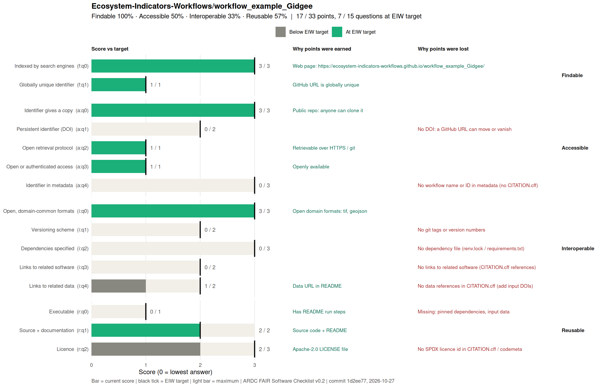

## Run Workflow:
1. copy the repository link
2. open a new project with git version history
3. choose local file path as you please
4. copy the repository
5. open the `.qmd` file
6. Click render option and get a cuppa, it will take 6-12 mins
7. `html` file will be opened automaticlaly in your default browser.

 Workflow Steps taken to re-design:

Species: 
1. Georgina gidgee (Acacia georginae F.M.Bailey) occurrences from GBIF on 13-Aug-2026-02:38:46.080849
2. CSV Data from TERN

Study Area: 
IBRA 7 selected areas
BRT	Burt Plain	MGD	Mitchell Grass Downs
CHC	Channel Country	MII	Mount Isa Inlier.
DEU	Desert Uplands	MUL	Mulga Lands
DMR	Davenport Murchison Ranges	SSD	Simpson Strzelecki Dunefields
FIN	Finke	STP	Stony Plains
GSD	Great Sandy Desert	TAN	Tanami
MAC	MacDonnell Ranges		

Map of known locations of Georgina gidgee woodlands overlain on the 89 biogregions of the Interim Biogeographic Regionalisation for Australia (IBRA 7) (Department of Environment, 2012). Records of occurrence obtained from the Atlas of Living Australia (www.ala.org.au/ accessed 22 March 2014).

Current raster Stack:
Baseline: Baseline/2000/ — bioclim_01–19, ibra, soil (2.5 arcmin)

Algorithm:
MaxEnt

Future raster Stack:
CMIP3/SRES: A1B/CSIRO_mk3.6/2.5_arcmin/{2030,2050,2070}
CMIP5/AR5: AR5/CSIRO_mk3.6/2.5_arcmin/{RCP26,RCP45,RCP60,RCP85}/{2030,2050,2070,2080}

Re-reunning this workflow
- clone the repository
- unzip the data folder(path should match otherwise if facing error check paths)
- Run Component 1 SDM

## Fair Check
<!-- FAIR:START -->
## FAIR assessment

 

**17 / 33 points · 7 / 15 questions at EIW target** · not yet at EIW minimum

| Principle | Score | EIW target |
|---|---|---|
| Findable | 4 / 4 (100%) | 4 / 4 |
| Accessible | 5 / 10 (50%) | 10 / 10 |
| Interoperable | 4 / 12 (33%) | 12 / 12 |
| Reusable | 4 / 7 (57%) | 6 / 7 |

Gaps to close (8)

- **a:q1 Persistent identifier (DOI)** (0 / 2): No DOI: a GitHub URL can move or vanish
- **a:q4 Identifier in metadata** (0 / 3): No workflow name or ID in metadata (no CITATION.cff)
- **i:q1 Versioning scheme** (0 / 2): No git tags or version numbers
- **i:q2 Dependencies specified** (0 / 3): No dependency file (renv.lock / requirements.txt)
- **i:q3 Links to related software** (0 / 2): No links to related software (CITATION.cff references)
- **i:q4 Links to related data** (1 / 2): No data references in CITATION.cff (add input DOIs)
- **r:q0 Executable** (0 / 1): Missing: pinned dependencies, input data
- **r:q2 Licence** (2 / 3): No SPDX licence id in CITATION.cff / codemeta

Updated 2026-10-27 from commit `1d2ee77` by `.fair/fair_check.R`. Edit `.fair/fair-checklist.yml`, not this block.
<!-- FAIR:END -->
